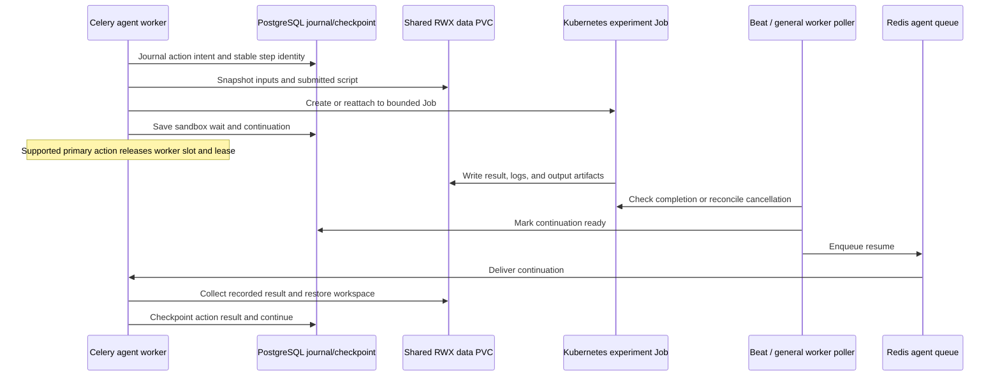

# Kubernetes integration

KnowledgeOps Lab supports three related capabilities: deploying the application
with Helm, scaling Celery worker pools with KEDA, and executing sandbox steps as
independent Kubernetes Jobs. Each is configured separately; installing the
application does not enable sandbox execution or autoscaling.

Use the [deployment runbook](../deploy/README.md) for minikube bootstrap,
application images, ingress, model providers, secrets, migrations, and managed
services. This guide describes the execution integration implemented by the
[Helm chart](../deploy/helm/knowledgedbchat/values.yaml) and
[sandbox runtime](../backend/app/services/kubernetes_sandbox.py).

## Execution architecture

| Layer | Kubernetes resources | Responsibility |
| --- | --- | --- |
| Application | Deployments, Services, gateway, optional ingress | API, UI, media streaming, and task production |
| Persistent services | StatefulSets and PVCs, or external services | PostgreSQL, Redis, Qdrant, MinIO, and optional Ollama |
| Task workers | Celery Deployments; optional KEDA ScaledObjects | General tasks, agent reasoning, LaTeX, and transcription |
| Scheduler | One Celery Beat Deployment | Periodic maintenance and sandbox continuation polling |
| Experiments | `batch/v1` Jobs and per-Job pods | Bounded sandbox commands with shared input/output storage |



The submission path is shared by callers of `run_in_sandbox`: compiler,
benchmark, sandbox-skill, custom Python, and research-program tools using that
interface. Direct Docker tools, image builds, and older experiment/demo runners
keep their existing Docker integration. The chart switches the general and
agent workers to Kubernetes; it does not switch the API's sandbox backend.

KEDA scales the long-lived Celery Deployments, not the experiment Jobs.
General workers use Redis queue depth; agent workers use PostgreSQL demand for
jobs that are running or ready to start. Paused sandbox waits do not inflate
agent-worker demand; ready continuations do. General workers retain at least
one replica for polling and other tasks. See
[worker autoscaling](../deploy/README.md#scale-celery-runners-in-production)
for broker requirements, sizing, drain windows, and switching from CPU HPA.

## Enable experiment Jobs

Before enabling the runner, provision:

- A shared data PVC backed by a CSI driver that supports real ReadWriteMany
  access across the worker and experiment nodes. The chart checks that
  persistence is enabled and `accessMode` is `ReadWriteMany`; it cannot prove
  that the storage driver supports the required behavior.
- A CNI that enforces NetworkPolicy. Other policies selecting experiment pods
  must not grant network access: Kubernetes combines allow rules additively.
  See the [NetworkPolicy documentation](https://kubernetes.io/docs/concepts/services-networking/network-policies/).
- Registry-accessible tool images containing `python3`, `/bin/sh`, and all
  dependencies needed offline. The image and PVC must work with uid/gid 65534.
  See [sandbox images](../deploy/sandbox-images/README.md) for builds.
- Celery Beat and a general worker for deferred continuations. An external
  scheduler must invoke
  `app.tasks.agent_job_tasks.poll_sandbox_continuations` itself.
- KEDA and its CRDs only if enabling the optional KEDA overlay.

Start with a private environment values file based on
[values-prod.example.yaml](../deploy/helm/knowledgedbchat/values-prod.example.yaml).
Configure application images, services, and secrets there. The following
additional file illustrates sandbox settings; replace the storage class and
image reference with resources available in your cluster:

```yaml
# my-sandbox-values.yaml
backend:
  persistence:
    enabled: true
    accessMode: ReadWriteMany
    storageClass: your-rwx-storage-class
    # existingClaim: your-shared-data-pvc

config:
  extra:
    ENABLE_UNSAFE_CODE_EXECUTION: "true"
    SCIENTIFIC_VALIDATION_ALLOWED_DOCKER_IMAGES: "registry.example.com/compiler-research@sha256:<digest>"

kubernetesSandbox:
  profiles:
    default: {}
    simulation:
      nodeSelector:
        workload: simulation
  imageProfiles:
    "registry.example.com/compiler-research@sha256:<digest>": simulation
```

Configure each tool's image setting to use that same allowlisted reference.
An image-profile mapping selects scheduling settings; it does not select the
image for a tool or add it to the allowlist. Profiles inherit the default
profile and can also set `tolerations`, `runtimeClassName`, `imagePullSecrets`,
and `extraResources` such as `nvidia.com/gpu: "1"`. Any referenced RuntimeClass,
device plugin, or registry pull Secret must already exist. Registry Secrets
listed in `global.imagePullSecrets` are inherited by the default profile.
CPU and memory remain bounded by `SCIENTIFIC_VALIDATION_MAX_CPUS` and
`SCIENTIFIC_VALIDATION_MAX_MEMORY_MB`.

Apply environment values first, optional scaling next, the Jobs overlay next,
and your final sandbox settings last:

```bash
helm upgrade --install kdbc deploy/helm/knowledgedbchat \
  -n knowledgedbchat --create-namespace \
  -f my-production-values.yaml \
  -f deploy/helm/knowledgedbchat/values-keda.yaml \
  -f deploy/helm/knowledgedbchat/values-kubernetes-jobs.yaml \
  -f my-sandbox-values.yaml \
  --wait --timeout 30m
```

Omit `values-keda.yaml` to keep static worker pools. The Jobs overlay only
enables `kubernetesSandbox.enabled`; execution enablement and image allowlists
remain explicit operator settings. Common sandbox steps no longer require a
worker Docker sidecar. For direct Docker integrations in the same workers,
set both `sandbox.enabled: true` and
`kubernetesSandbox.keepDockerSidecar: true`.

The minikube bootstrap is useful for application smoke tests, but its default
storage profile does not satisfy the experiment runner's RWX requirement.
Provision compatible storage and network enforcement before testing Jobs.

## Waiting, recovery, and evidence

`kubernetesSandbox.defer.enabled` defaults to `true`. Supported journaled
primary actions in the native agent loop save a continuation and release their
worker slot after submission. Beat schedules the general-queue poller every
30 seconds; it examines up to `defer.pollBatchSize` records per tick (default
20). Resumption finishes the saved action in its original iteration without
another model decision or another tool-invocation charge. Original agent
deadlines and owner running-job caps remain in force.

Verification/recovery side actions, external harnesses, calls without a native
journaled action, and redacted journal parameters retain synchronous waiting.
Wall-clock benchmarks and comparisons also keep their waiter while holding a
measurement lock. Add other tools to `defer.tools` only after making their
side effects safe to replay. Setting `defer.enabled: false` changes new calls
to synchronous waiting; drain existing waits before removing the poller.

Each journaled sandbox step has a stable identity. Retries with matching inputs
reattach to the original Job or collect its recorded result; changed inputs,
settings, or Job identity require reconciliation. Calls without journaling
receive fresh identities. A worker crash leaves the experiment bounded by its
deadline rather than tied to the worker pod's lifetime.

Records and artifacts live under `/app/data/kubernetes-sandbox/<job-name>/`.
They include original inputs, the script, Job/pod and node identity, resolved
image ID, result, logs, and output files. Tool results expose `sandbox_jobs`
and artifact references through the execution journal. Workspace and
deterministic-cache directories are `/app/data/sandbox-workspaces` and
`/app/data/sandbox-result-cache`. Digest-pinned images permit deterministic
caching across nodes; mutable tags bypass that cache. Replay restores file
contents, executable modes, and deletions before subsequent steps consume them.

## Isolation and lifecycle limits

The trusted worker service account can create/get/delete Jobs and list pods in
the release namespace. Experiment pods use a separate service account with no
RoleBinding or mounted API token, and receive no application Secrets or app
environment. They mount only their own workspace, read-only launcher directory,
and output directory from the shared claim, plus bounded `/tmp` scratch space.
Pods run as uid/gid 65534 with a read-only root filesystem, dropped capabilities,
seccomp, and no privilege escalation. The chart always renders their deny-all
NetworkPolicy when the runner is enabled, independently of application policies.

| Setting under `kubernetesSandbox` | Default | Meaning |
| --- | --- | --- |
| `maxTimeoutSeconds` | `21600` | Six-hour step ceiling; tool and agent deadlines may shorten it |
| `ttlSecondsAfterFinished` | `86400` | Completed Kubernetes objects expire after one day |
| `maxInputMB` / `maxOutputMB` | `512` / `1024` | Bounded input/output artifact collection |
| `logBytes` | `2097152` | Captured log byte limit |
| `pollSeconds` | `5` | Synchronous waiter polling interval |

Jobs request one completion with parallelism one, `backoffLimit: 0`, and an
active deadline that includes scheduling and startup. Kubernetes can still
duplicate execution under failures, so experiment code must tolerate replay;
stable submission identity is not an exactly-once guarantee. See
[Kubernetes Job behavior](https://kubernetes.io/docs/concepts/workloads/controllers/job/).

The launcher applies a per-UID process limit of 256; configure the sandbox
nodes' kubelet `podPidsLimit` for a cgroup process bound. Artifact limits do not
limit total live PVC usage. Monitor storage and remove retained records only
when their owning runs no longer need recovery or audit. Kubernetes object
expiry does not remove those persistent files.

Cancel or drain experiments and confirm cleanup before disabling the runner,
removing its scheduler, or uninstalling. Cancellation checks the request
fingerprint and Job UID before foreground deletion. The experiment NetworkPolicy
is retained by Helm so in-flight Jobs stay confined; remove it only after all
affected Jobs terminate.

## Validate and troubleshoot

Run local chart checks before installing:

```bash
make helm-lint
make helm-test
make helm-template
# Optional: requires kubeconform and access to Kubernetes/KEDA schemas.
make helm-validate
```

For an installed release named `kdbc` in `knowledgedbchat`:

```bash
make k8s-status K8S_NAMESPACE=knowledgedbchat K8S_RELEASE=kdbc
make k8s-test K8S_NAMESPACE=knowledgedbchat K8S_RELEASE=kdbc
kubectl -n knowledgedbchat get jobs,pods \
  -l app.kubernetes.io/component=sandbox-job
kubectl -n knowledgedbchat get scaledobjects,hpa  # when KEDA is enabled
kubectl -n knowledgedbchat logs deployment/kdbc-knowledgedbchat-celery --tail=100
kubectl -n knowledgedbchat logs deployment/kdbc-knowledgedbchat-celery-beat --tail=100
```

| Symptom | Check |
| --- | --- |
| Chart rejects experiment settings | Persistence must be enabled with `accessMode: ReadWriteMany` |
| Job remains Pending | Pod events, bound PVC, node selector/tolerations, resources, RuntimeClass, and image pull credentials |
| Execution disabled or image rejected | Execution flag, exact image allowlist, and the tool's configured image reference |
| Permission denied or launcher fails | Image has `python3` and `/bin/sh`; shared storage allows uid/gid 65534 to use its workspace |
| Experiment finished but agent waits | Beat, general worker, Redis dispatch, worker logs, and `results.sandbox_wait` errors |
| Worker pool does not scale | KEDA installation, ScaledObject readiness/events, Redis/Postgres access, and replica bounds |
| Retry reports an identity conflict | Preserve artifacts and reconcile the original action, request fingerprint, and Job UID before relaunching |

`helm test` checks application connectivity; it does not prove sandbox isolation
or recovery. In staging, run a representative experiment, interrupt its waiter,
retry the journaled action, and verify Job identity reuse plus output restoration.
Also verify CNI isolation, cross-node RWX behavior, cancellation, and worker
scale-down with your actual cluster drivers and runtime before production use.
